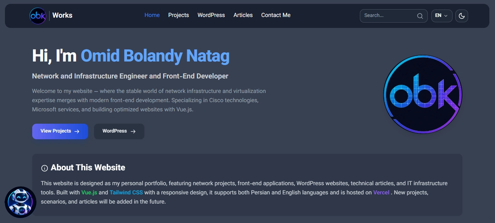
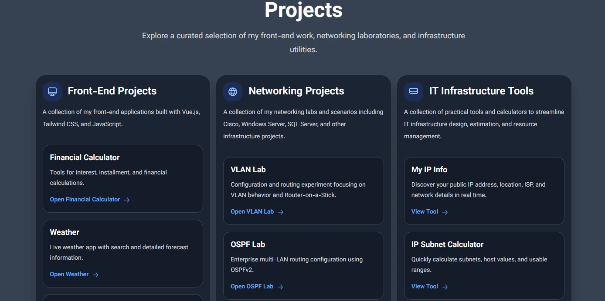
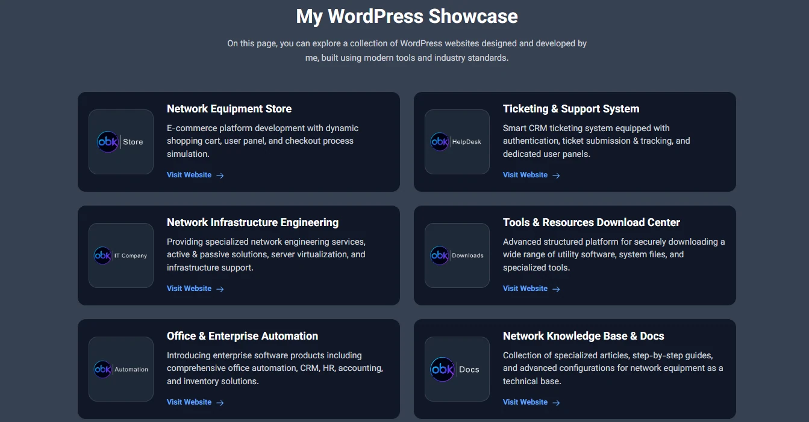
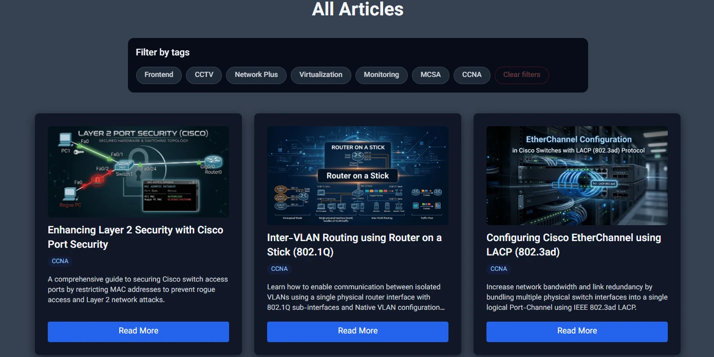
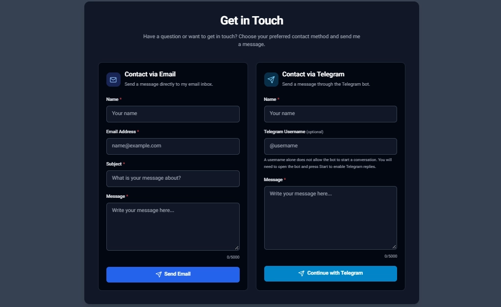

# 🌐 IT Portfolio Website

A modern bilingual portfolio website built to showcase my IT skills, projects, technical articles, and WordPress websites.

[](https://vuejs.org/)
[](https://tailwindcss.com/)
[](https://maplibre.org/)
[](https://upstash.com/)
[](https://vercel.com/)
[](https://www.cloudflare.com/dns/)
[](https://www.obkworks.tr)


## 🚀 Live Portfolio

https://www.obkworks.tr

---

## ℹ️ Project Information

- **Version:** 1.4.0
- **Status:** Stable
- **License:** © 2026 obk Portfolio. All rights reserved.

---

## 📖 About

This website was developed as a personal portfolio to demonstrate practical experience in networking, system administration, virtualization, monitoring, and web development.

The website features a responsive interface, Persian (RTL) and English (LTR) language support, light and dark themes, interactive utilities, technical articles, and dedicated pages for contact and WordPress-related services.

---

## ✨ Features

- 🌍 Bilingual interface (Persian / English)
- 🌙 Dark and light themes
- 📱 Responsive design
- 📬 Contact page with separate email and Telegram - contact forms
- 🤖 Telegram-based support workflow
- 🛡️ Server-side API validation, CAPTCHA - verification, and rate limiting
- 🌐 WordPress services and resources page
- 🌦 Weather application
- 🗺️ Interactive maps and geolocation
- 📡 IP information and network geolocation tools
- 📅 Date and time utilities
- 🧮 IT infrastructure tools, including subnet, RAID, - and CCTV storage calculators
- 📚 Technical articles
- 💻 Front-end projects
- 🌐 Networking and infrastructure labs
- 🔐 Serverless API integration via Vercel
- ⚡ Redis-backed data storage and rate limiting

---

## 🛠 Built With

### Front-end

- HTML5
- CSS3
- JavaScript (ES6+)
- Vue.js 3
- Vue Router
- Vue I18n
- Tailwind CSS
- MapLibre GL JS

### Deployment

- GitHub
- Vercel
- Cloudflare DNS

### Database & Caching

- Upstash Redis

### External APIs & Services

- **Maps & Geocoding:**
  - MapTiler API
  - Neshan Maps API
  - geoapify API

- **IP & Location:**
  - IPInfo API
  - IPWho API
  - ipify API

- **Financial & Utilities:**
  - OpenWeatherMap API
  - ExchangeRate API

- **Communication & Messaging:**
  - Telegram Bot API
  - Resend Email API

---

## 📂 Project Categories

### Front-end Projects

- Financial Calculator
- Weather Application
- Map
- Todo List
- Calendar
- Unit Conversion
- QR & Barcode Generator
- BMI Calculator
- Calculator
- Time & Date
- Modals

### Network Projects

- VLAN Lab
- OSPF Lab
- EIGRP Dynamic Routing
- EtherChannel (LACP) Configuration
- Access Control Lists (ACL)
- Port Security & DHCP Snooping
- Active Directory, GPO & FSRM
- DHCP Failover & DNS Lab
- SQL Server & T-SQL Lab Scenario

### IT Infrastructure Tools

- My IP Info
- IP Subnet Calculator
- Troubleshooting Simulator
- CCTV Storage Calculator
- RAID Calculator
- VM Resource Allocator
- Data Unit Converter

---

## 🌐 WordPress Websites & Services

- 🛒 [obk | Store](https://store.obkworks.tr)
- 🎫 [obk | Helpdesk](https://helpdesk.obkworks.tr)
- 🏢 [obk | Company](https://company.obkworks.tr)
- 📥 [obk | Downloads](https://downloads.obkworks.tr)
- ⚙️ [obk | Automation](https://automation.obkworks.tr)
- 📚 [obk | Docs](https://docs.obkworks.tr)

---

## 📷 Screenshots

### 🏠 Home Overview



### 🛠️ Projects & Infrastructure Tools



### 🌐 WordPress Services



### 📚 Technical Articles



### 📬 Contact & Support



---

## 📦 Installation

### Prerequisites

- Node.js and npm
- Git

```bash
git clone https://github.com/omidbolandy/obkworks.git
cd obkworks
npm install
npm run dev
```

---

## 📈 Future Improvements

- Additional IT infrastructure tools
- More networking and system administration labs
- More technical articles
- Performance and accessibility improvements
- Additional interactive utilities
- Further enhancements to website services and - communication features

---

## 👨‍💻 Author

**Omid Bolandy Natag**

- GitHub: [omidbolandy](https://github.com/omidbolandy)
- Website: [obkworks.tr](https://www.obkworks.tr)
- LinkedIn: [omid bolandy](https://www.linkedin.com/in/omid-bolandy/)
- Email: [omidbolandy@gmail.com](https://mail.google.com/mail/?view=cm&fs=1&to=omidbolandy@gmail.com)
- Telegram Support Bot: [obk Works Support](https://t.me/obkWorksBot)

---

## 📄 Notice

This repository is intended for portfolio and demonstration purposes.

If you would like to use any part of this project, please contact the author first.

---

⭐ If you found this project useful, consider giving it a Star.
